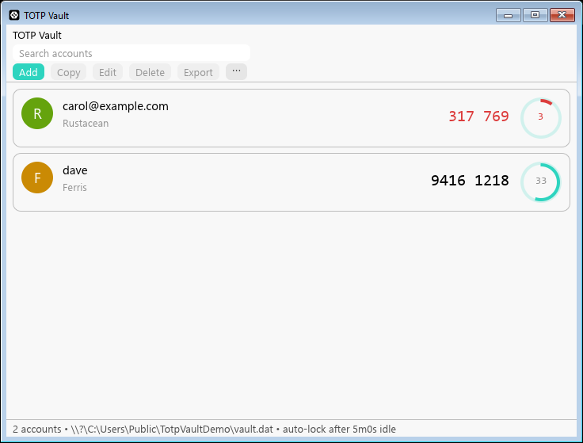
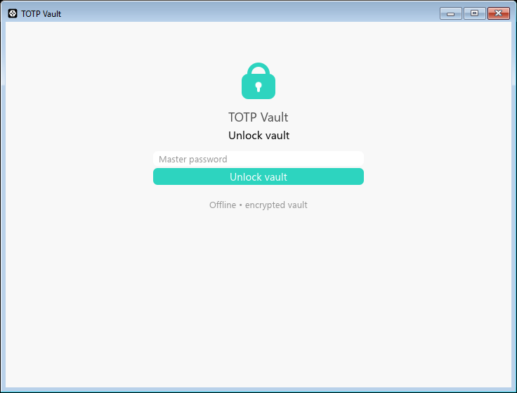

# TOTP Vault

A small offline authenticator for Windows, Linux and macOS, written in Rust with `egui`.

## Screenshots




## Features

- Create and unlock an encrypted vault with a master password.
- Add, edit, delete and search TOTP accounts (list sorted alphabetically; search shows `showing X of Y`).
- Duplicate protection: same name+issuer or same secret with identical settings is rejected.
- Import `otpauth://totp/...` provisioning URIs.
- Export a selected account as a provisioning URI for import in another app.
- Paste a QR screenshot from the clipboard (`Paste QR`): the image is decoded
  offline and the enclosed provisioning URI is imported (PNG/JPEG, ≤5 MiB).
- SHA-1, SHA-256 and SHA-512; 6 or 8 digits; configurable period (default 30 seconds).
- Live codes and countdown rings (red under 6 seconds); copy with the button, double-click or Enter.
- Optional privacy: hide codes until selected (Settings).
- Clear copied codes and exported URIs after 15 seconds, if the clipboard still contains them.
- Manual lock and auto-lock after 5 minutes of inactivity (1–15 minutes per session, wall-clock backstop for sleep).
- Change the master password from Settings. About dialog shows the vault path and backup reminder.
- Interface in English, French, German, Italian, Spanish, Chinese (Simplified) and Greek (auto-detected, switchable in Settings).
- No server, account registration, telemetry or network requests.

Vault format v1 is unchanged since 1.x: v1 vaults open directly in v2.
The Go/Fyne implementation (up to 1.2.0) is preserved read-only in `archived/go/`.

## Run

Download the Windows ZIP, Linux tar.gz or macOS tar.gz from the [latest release](https://github.com/spapas/totpvault/releases/latest). Each release includes all three binaries and a `SHA256SUMS` file.

Extract the archive, then start `totpvault.exe` (Windows), `./totpvault` (Linux, needs an OpenGL-capable desktop) or `./totpvault` (macOS, Apple Silicon).

On Windows with [Scoop](https://scoop.sh), install and update instead via the
[personal bucket](https://github.com/spapas/scoop-bucket):

```powershell
scoop bucket add totpvault https://github.com/spapas/scoop-bucket
scoop install totpvault
```

On first launch, choose a unique master password with at least 12 characters. A forgotten password cannot be recovered. Click **Add** to enter a Base32 secret, **Import URI** to paste a provisioning URI, or **Paste QR** to decode a QR screenshot from the clipboard (copy it first with Win+Shift+S / screenshot tool). Select an account to copy, edit or delete it.

Select an account and choose **Export** to copy its `otpauth://` provisioning URI for another authenticator. The URI contains the account's TOTP secret; it is copied only after confirmation and the clipboard is cleared after 15 seconds if unchanged. Other apps or clipboard history may retain a copy.

The default encrypted file is:

| OS | Location |
|---|---|
| Windows | `%APPDATA%\TotpVault\vault.dat` |
| Linux | `$XDG_DATA_HOME/TotpVault/vault.dat`, or `~/.local/share/TotpVault/vault.dat` |
| macOS | `~/Library/Application Support/TotpVault/vault.dat` |

Choose another file with `totpvault --vault /path/to/vault.dat` (Windows: `totpvault.exe --vault C:\path\vault.dat`). Only one process can open a given vault. Close the app before copying or restoring the file.

Back up **vault.dat** to another safe location. It remains encrypted, and the same file works on all platforms. Changing the master password re-encrypts the current vault; older backups still require their original password. Keep the computer clock synchronized for correct codes.

## Build

Install the stable Rust toolchain (Windows needs the MSVC linker):

```powershell
# Windows (Scoop) or rustup: stable-x86_64-pc-windows-msvc
scoop install rust-msvc
git clone --branch master https://github.com/spapas/totpvault.git
cd totpvault
cargo test --locked
cargo run -p totpvault [-- --vault PATH]
cargo build --locked --release -p totpvault
```

Linux (Ubuntu/Debian), then the same `cargo` commands:

```sh
sudo apt-get install gcc pkg-config libgl1-mesa-dev libegl1-mesa-dev xorg-dev libwayland-dev libxkbcommon-dev
git clone --branch master https://github.com/spapas/totpvault.git
cd totpvault
cargo test --locked
cargo run -p totpvault
```

macOS (Apple Silicon, Xcode command-line tools), then:

```sh
git clone --branch master https://github.com/spapas/totpvault.git
cd totpvault
cargo test --locked
cargo run -p totpvault
```

GUI uses `eframe` on the `glow`/OpenGL renderer. Checks run in CI on all three platforms: `cargo fmt --check`, `cargo test --locked`, `cargo clippy --all-targets --locked -- -D warnings`, `cargo audit`, release build.

## Publishing releases

Update `VERSION` (for example, `2.0.0`) and push to `master`. Once all three platforms pass all checks, the workflow creates the matching `v2.0.0` tag and publishes a GitHub Release with Windows ZIP, Linux tar.gz, macOS tar.gz and checksums. Pushing a `v*` tag matching `VERSION` also publishes that version after the checks pass. Existing published releases are preserved; ordinary commits with the same version do not replace their downloads.

## Layout

| Path | Purpose |
|---|---|
| `app` | `totpvault` binary: entry point, paths, exclusive instance lock, `egui` UI + session lifecycle |
| `crates/totp` | RFC 6238 generation and provisioning URI parsing |
| `crates/vault` | Password derivation, authenticated encryption, atomic saves |
| `crates/qrimg` | Offline QR image decode (clipboard PNG/JPEG → URI text) |
| `crates/i18n` | Offline UI translations (EN source; FR/DE/IT/ES/ZH/EL), OS language detect |
| `interop` | Cross-compatibility fixtures (`go-vault.dat`, `rust-vault.dat`) |
| `archived/go` | Read-only Go/Fyne 1.x implementation (up to 1.2.0) |
| `scripts/package_release.py` | CI packaging: validates `VERSION` + `MZ`/`ELF`/`Mach-O` magic, zips/tarballs binaries + docs, writes `SHA256SUMS` |

See [ARCHITECTURE.md](ARCHITECTURE.md) for component and data-flow overview, [SECURITY.md](SECURITY.md) for the format, threat model and limitations, and [docs/VALIDATION.md](docs/VALIDATION.md) for the checks performed. Agents contributing code should start with [AGENTS.md](AGENTS.md).

Camera capture and bulk export/import are not implemented; only single-account URI import/export and single QR screenshots pasted from the clipboard are supported.
